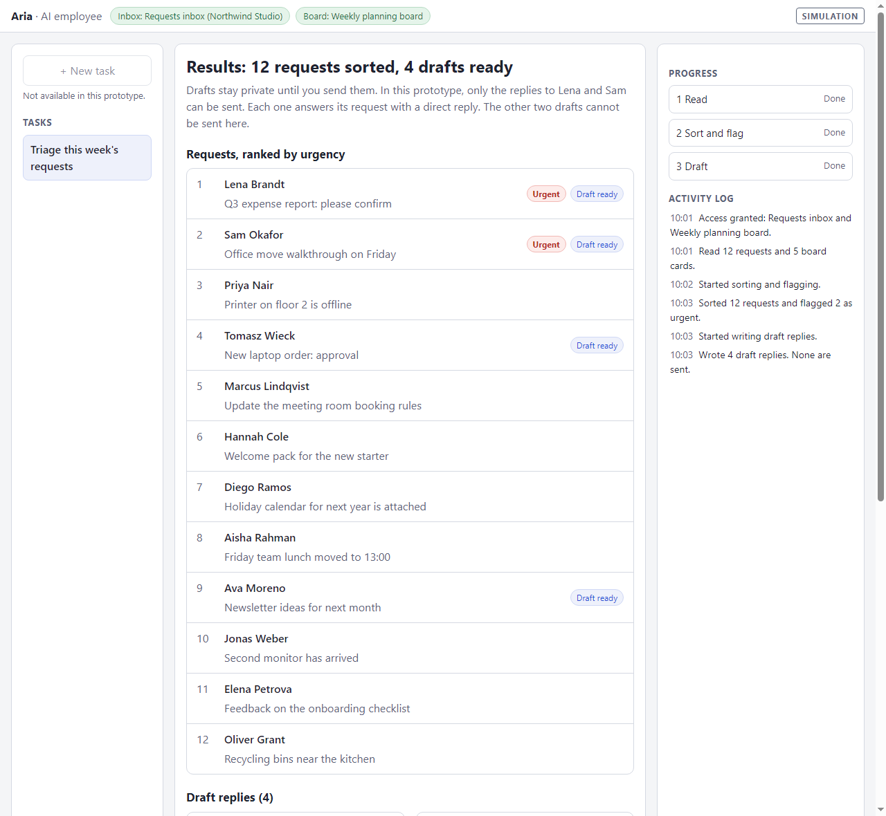
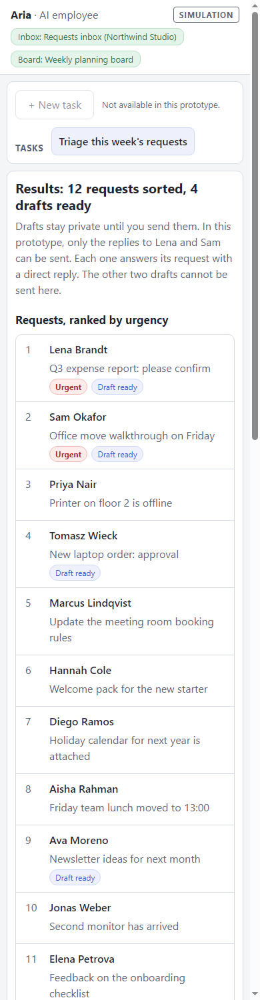

# AI Employee First Handoff

A small interactive prototype of handing a first task to an AI employee. The AI employee is "Aria" and you play Maya, who runs operations at a small company. Aria reads an inbox, sorts 12 requests, flags the urgent ones and writes draft replies. Aria never sends anything without Maya's approval.

Everything is scripted and simulated. It is not a real AI, and all names, companies and messages are fictional.

## Try it

Live site: https://korneliakowalczyk9.github.io/ai-employee-prototype/

Or open `index.html` in a browser. There is nothing to install.

## What you can try

- Grant or refuse access to the inbox and the board.
- Watch Aria work through three stages, and press Stop to see it pause at the next checkpoint. Then resume.
- Read the ranked requests and the four draft replies, and edit a draft.
- Send the replies to Lena and Sam. Each send needs its own approval, and a second send says the earlier approval does not carry over. A sent draft is locked.
- Open the summary of what Aria did.

## How it is built

- Plain HTML, CSS and JavaScript, with no dependencies, no backend, no tracking and no network calls. Nothing is stored, so a reload starts again.
- Responsive: three columns on a wide screen and one column on a phone.
- Keyboard friendly: focus starts on Cancel in the send dialog, Tab stays inside it and Escape cancels.

## Notes

- The activity log times are simulated.
- Checked by hand in Edge at desktop and phone widths. Not tested in other browsers or with a screen reader.
- The design work and the research notes for this project are in a separate repository: [ai-employee-first-handoff](https://github.com/korneliakowalczyk9/ai-employee-first-handoff).
